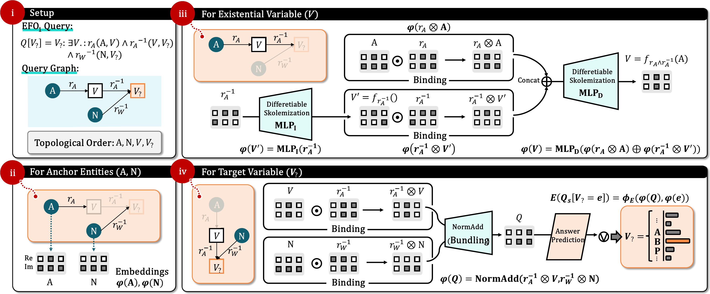

# LVSA: Existentially Consistent Skolemized Reasoning

**Existentially Consistent Skolemized Reasoning for Complex Query Answering on Knowledge Graphs**<br>
Yuyin Lu, Hegang Chen, Shanrui Xie, Yanghui Rao, Haoran Xie, Fu Lee Wang, and Qing Li<br>
*The 35th ACM International Conference on Information and Knowledge Management (CIKM 2026)*

[Project website](https://luyy9apples.github.io/LVSA/) · [Paper PDF](docs/LVSA_CIKM2026.pdf) · [Code](https://github.com/luyy9apples/LVSA)

LVSA (Logic-constrained Vector Symbolic Architecture) answers complex first-order queries over incomplete knowledge graphs. It builds and reuses a latent state for each existential variable so that the same variable can satisfy all of its connected constraints. The method combines vector-symbolic composition, differentiable Skolemization, and a logic-regularized neural negator.

<p align="center">
  
</p>

## Why LVSA?

Complex query answering requires reasoning through existential variables shared by multiple relations. Grounding-based approaches enumerate candidate entities, preserving logical constraints at a substantial inference cost. Latent Skolemization avoids enumeration, but a single query representation can lose the identity of a shared existential variable. LVSA assigns each such variable a persistent, constraint-conditioned latent state and reuses it wherever the variable appears.

- **Vector-symbolic composition** binds entity and relation embeddings and combines atomic constraints.
- **Differentiable Skolemization** constructs a latent state for each existential variable in topological order.
- **Logic-guided negation** regularizes a neural negator using logical laws, including double negation.

The paper analyzes structural expressivity for acyclic EFO₁ queries and evaluates reasoning accuracy, existential consistency, and inference efficiency.

## Results at a glance

Average filtered MRR (%) on the standard BetaE benchmark splits. `A_p` averages existential positive queries, `A_n` averages queries involving negation, and `A` averages all evaluated queries. The full per-query results, additional benchmarks, and experimental details are in the paper.

| Dataset | LVSA `A_p` | LVSA `A_n` | LVSA `A` | Best prior Skolemization-based `A` in our comparison |
| --- | ---: | ---: | ---: | ---: |
| FB15k | 59.9 | 27.7 | **48.4** | 41.8 (CLMPT) |
| FB15k-237 | 28.8 | 10.9 | **22.4** | 19.4 (CLMPT) |
| NELL995 | 32.4 | 9.1 | **24.1** | 22.6 (LMPNN / CLMPT) |

These numbers compare methods in the Skolemization-based group under the reported benchmark protocol; they are not a comparison against every grounding-based method. The paper also reports experiments on fully unobservable queries and a two-level evaluation of empirical existential consistency.

## Repository contents

| Path | Description |
| --- | --- |
| [`main.py`](main.py) | Training and evaluation entry point. |
| [`src/logic_vsa.py`](src/logic_vsa.py) | LVSA model and query reasoning. |
| [`models.py`](models.py) | Query reasoning model wrapper and evaluation routines. |
| [`scripts/`](scripts/) | Dataset-specific training and evaluation commands. |

## Reproducing the experiments

The provided shell scripts assume a CUDA-capable GPU, a Unix-compatible shell, and the directory layout shown below. The paper's experiments used a single NVIDIA RTX 3090 (24 GB). Pretrained embeddings and datasets are **not** included in this repository.

### 1. Install the environment

```bash
conda create -n lvsa python=3.9
conda activate lvsa
pip install torch==2.2.2 numpy==1.24.4 tensorboardX tqdm
```

Choose a PyTorch build compatible with your CUDA installation if needed. The commands above list the Python packages imported by the repository; dependency versions other than PyTorch and NumPy were not pinned in the original instructions.

### 2. Download query datasets

Download the [BetaE/Query2box KG data](http://snap.stanford.edu/betae/KG_data.zip) for FB15k, FB15k-237, and NELL995. Extract the dataset directories into `../KG_data/` relative to this repository, so paths such as `../KG_data/FB15k-betae` exist. The paper also evaluates newer fully unobservable query benchmarks; those data and their protocols are described in the paper.

### 3. Prepare ComplEx embeddings

LVSA initializes its entity and relation embeddings from pretrained ComplEx embeddings (`rank=1000`). The original project used [facebookresearch/ssl-relation-prediction](https://github.com/facebookresearch/ssl-relation-prediction) to train them. In that repository, the reported pretraining commands are:

```bash
python -u main.py --dataset FB15K --score_rel True --model ComplEx --rank 1000 --learning_rate 0.05 --batch_size 100 --lmbda 0.01 --w_rel 0.1 --max_epochs 100 --seed 114514
python -u main.py --dataset FB15K-237 --score_rel True --model ComplEx --rank 1000 --learning_rate 0.1 --batch_size 1000 --lmbda 0.05 --w_rel 4 --max_epochs 500 --seed 114514
python -u main.py --dataset NELL995 --score_rel True --model ComplEx --rank 1000 --learning_rate 0.1 --batch_size 1000 --lmbda 0.05 --w_rel 0.1 --max_epochs 500 --seed 114514
```

Export the trained embeddings to the `.pt` files expected by the scripts: `../kge/FB15k_emb.pt`, `../kge/FB15k-237_emb.pt`, and `../kge/NELL_emb.pt`. Check the path and filename in each script before running it; the upstream pretraining repository does not create these LVSA-specific files automatically.

```text
parent/
├── KG_data/
│   ├── FB15k-betae/
│   ├── FB15k-237-betae/
│   └── NELL-betae/
├── kge/
│   ├── FB15k_emb.pt
│   ├── FB15k-237_emb.pt
│   └── NELL_emb.pt
├── LVSA_model/             # created during training
└── LVSA/                   # this repository
```

### 4. Train and evaluate

Run these commands from the repository root. The training scripts fit the differentiable Skolemization module first, then the neural negator. Model checkpoints are written under `../LVSA_model/`.

```bash
bash scripts/train_fb15k.sh
bash scripts/train_fb15k237.sh
bash scripts/train_nell.sh
```

After training, run the matching evaluation script:

```bash
bash scripts/eval_fb15k.sh
bash scripts/eval_fb15k237.sh
bash scripts/eval_nell.sh
```

The scripts set `CUDA_VISIBLE_DEVICES` explicitly. Change those device indices to match your machine.

## Supplementary baseline comparison

The original repository reports additional average MRR (%) scores for Skolemization-based baselines below. A dash means the model does not support that query family. PPMT was trained for 24 hours here; this is shorter than the estimated training time required for its full convergence, so its scores should be read with that qualification.

| Model | FB15k `A_p` | FB15k `A_n` | FB15k `A` | FB15k-237 `A_p` | FB15k-237 `A_n` | FB15k-237 `A` | NELL995 `A_p` | NELL995 `A_n` | NELL995 `A` |
| --- | ---: | ---: | ---: | ---: | ---: | ---: | ---: | ---: | ---: |
| CQD-CO | 45.3 | 4.6 | 30.8 | 19.8 | 1.7 | 13.3 | 28.4 | 1.9 | 18.9 |
| BetaE | 41.6 | 11.8 | 31.0 | 20.9 | 5.5 | 15.4 | 24.6 | 5.9 | 17.9 |
| ConE | 49.8 | 14.8 | 37.3 | 23.4 | 5.9 | 17.1 | 27.1 | 6.4 | 19.7 |
| PPMT (24 h) | 16.4 | – | – | 15.5 | – | – | 17.1 | – | – |
| LMPNN | 50.6 | 20.0 | 39.7 | 24.1 | 7.8 | 18.3 | 30.7 | 8.0 | 22.6 |
| CLMPT | 55.1 | 17.9 | 41.8 | 25.9 | 7.9 | 19.4 | 31.3 | 7.0 | 22.6 |
| **LVSA** | **59.9** | **27.7** | **48.4** | **28.8** | **10.9** | **22.4** | **32.4** | **9.1** | **24.1** |

PPMT: Xingrui Zhuo et al. “Progressive Prefix-Memory Tuning for Complex Logical Query Answering on Knowledge Graphs.” *IJCAI*, 2025.

## Citation

If you use this code or build on the paper, please cite:

```bibtex
@inproceedings{lu2026existentially,
  title     = {Existentially Consistent Skolemized Reasoning for Complex Query Answering on Knowledge Graphs},
  author    = {Lu, Yuyin and Chen, Hegang and Xie, Shanrui and Rao, Yanghui and Xie, Haoran and Wang, Fu Lee and Li, Qing},
  booktitle = {Proceedings of the 35th ACM International Conference on Information and Knowledge Management},
  year      = {2026}
}
```

## Acknowledgements

The implementation builds on [CQD/KGReasoning](https://github.com/pminervini/KGReasoning/). We thank the authors of the referenced datasets, baselines, and pretraining code.
